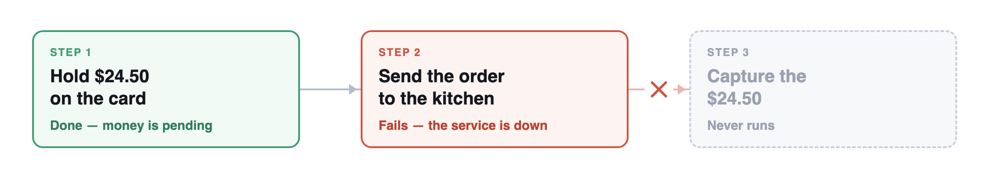

import Link from '@docusaurus/Link';

:::note Tutorial information

- **Level**: Temporal beginner
- **Time**: ~1 hour
- **What you'll build**: A food delivery order that rides out a kitchen outage, never holds a customer's card twice, and stops right away on a declined card.

:::

Avery orders a $24.50 pizza. The delivery app puts a hold on Avery's card, then sends the order to the kitchen, but the kitchen's ordering system is down, so the call fails. The app gives up there. The $24.50 is held on Avery's card, the kitchen never heard about the order, and nothing in the app remembers that the order stopped halfway.

The obvious fix is to run the order again, but that makes things worse. The app starts over from the first step, places a second $24.50 hold, and fails at the kitchen again. Avery now has $49.00 tied up and no food on the way.

In this lab, we'll make that app fail in a real sandbox, then rebuild it with Temporal so the order remembers how far it got, keeps retrying the kitchen until it comes back, and never charges the card twice. Temporal calls this **durable execution**. We'll write the Temporal pieces ourselves: a Worker, a client, a Workflow, and the retry rules for each step.

## Prerequisites

- Comfortable reading TypeScript. No Temporal experience needed.

## Run the lab in your browser (recommended)

Everything runs in the sandbox: the Temporal Service, the Web UI, a code editor, and the two backend services the order calls. You don't need a Temporal Cloud account or anything installed locally.

  Try the Free Interactive Lab. No setup.

<iframe
    width="100%"
    height="472"
    sandbox="allow-forms allow-modals allow-popups allow-same-origin allow-scripts allow-popups-to-escape-sandbox"
    src="https://play.instruqt.com/embed/temporal/invite/sqi7kbshmuba"
    style={{border: 0}}
    allowFullScreen
></iframe>

## Next Steps

From here, our free [Temporal 101 with TypeScript](/courses/temporal_101/typescript) course goes deeper into Workflows, Activities, and the Event History. Thanks for building along with us.

Have feedback on this tutorial? [Share your thoughts in our quick form](https://docs.google.com/forms/d/e/1FAIpQLSc3EhkNSJ7M73evqLehgdOW787Gnmg5ZdJpNvdW4owRXf0zpQ/viewform?usp=header). It helps us improve.
